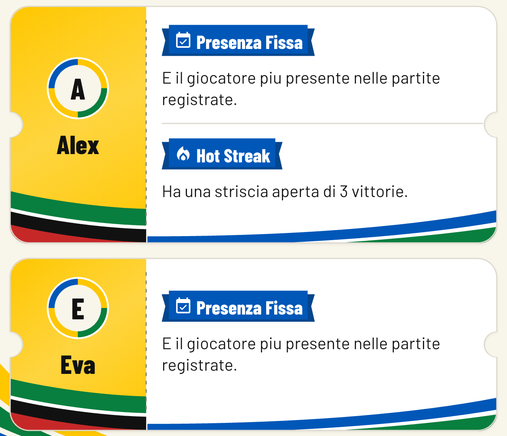

# Ranking award tickets — approved R1

Concept 3 is implemented on `codex/runtime-style-selection`. The user explicitly approved this exact painter and the running Alex/Eva preview on **13 October 2026**. These images are retained review evidence and are not registered runtime assets. [manifest.json](manifest.json) records the source and image hashes. The selected concept and exact generation prompt are retained here for provenance.

[Full native screen](native-final-preview.png) · [Pair tickets](native-pair-tickets.png) · [Isolated painter](ticket-artwork-isolated.png) · [Selected concept](selected-concept.png)

[Normal component specimen](tickets-normal.png) · [200% text specimen](tickets-large.png) · [Long pair names](tickets-long-pair.png)

The normal ticket retains the selected yellow identity stub, ring avatars, white award area, folded blue badges, dashed perforation, notches and lower colored sweeps. Existing Flutter fonts and geometry replace generated lettering. The original live `PlayerBadge.description` is displayed verbatim, including its current streak; it is longer than the concept's illustrative copy. Component specimens use synthetic accented descriptions; native screenshots show the existing service copy. The authored painter uses shared color tokens, a restrained yellow gradient and flat ribbon bands. Long names or enlarged text move identity above awards and omit decoration/perforation; the podium's established large-text fallback remains unchanged.

Reuse: `PassTicketShape`, extracted `TicketPerforation`, `RankingIdentity`, exposed `RankingBadge`, existing tokens and fonts. New: `RankingAwardTicket` composition and `RankingAwardTicketArtwork` sweeps. No runtime PNG/SVG, business-rule change or new ticket action. Avatar scale-down is local to pair tickets; text retains the user's scale. Altro/Dati and Italia keep their existing presentations.

Verification: 414 Flutter tests, clean analysis, simulator build, pinned DESIGN lint (zero errors/warnings), seven artwork provenance checks, and unchanged hashes for 252 protected files. Only the two directly affected additional-award goldens change. The inherited Italia relative-date golden fixture was repaired after reproducing its Oggi/date mismatch on baseline 70d720a; frozen reference PNGs and production Italia code remain unchanged.

Native portrait review used the selected iPhone 17 Pro Max iOS 26.5 and existing isolated QA app, with production-identical Flutter resources. Reviewed 1vs1/2vs2, Generale/Marcatori, ticket scrolling, profile/back, large-text stacked fallback, Altro/Dati and Italia via Aspetto. One reversible QA pair match exercised actual three-game badge eligibility. It was removed afterward; all original 8 players, 9 matches and 4 settings equal their pre-review records, and content size `large` is restored. The normal user app was not modified. Native accessibility-extra-large still clips the pre-existing inactive Generale segment label, as already recorded in the runtime implementation receipt; its action remains reachable. No new landscape, VoiceOver, reduced-motion or performance verification is claimed.

Crops remove only unused component-canvas whitespace or surrounding native screen content. The manifest records original capture hashes and crop rectangles; native full frames remain available. All captures were visually inspected against concept 3. Text, identity, award counts and decoration remain readable in the reviewed ticket states. The explicit approval covers the exact painter source hash and isolated/in-context rendering recorded in this packet. Materially revised artwork requires renewed review.

Automated logs, restoration records and failure-before-repair evidence stay in the ignored feature-plan packet through exact-version review and verified primary-branch landing. The approved implementation is checkpointed locally. No push, PR, merge or release is authorized; the packet remains retained until verified primary-branch landing.
